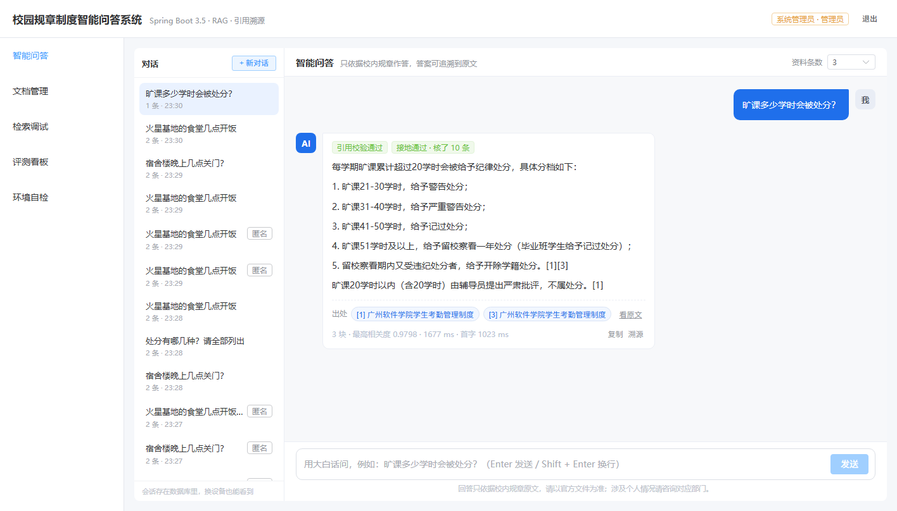

# 校园规章制度 RAG 智能问答系统

面向在校学生与新生的校园规章问答系统：**答案只依据校内规章原文生成，句句可溯源，答不出会明确拒答**。

> 课程、学籍、奖惩、宿舍、资助、请假、考试纪律……33 份校内规章（24 万字）里的问题，都能用大白话问。
> 系统先把相关条款检索出来（向量 + BM25 双路 → RRF 融合 → Cross-Encoder 精排 → 展开邻居），
> 再让大模型照着条款作答，并对**引用编号**和**硬事实**（数字、期限、处分等级）做两道校验。



---

## 一、这个项目解决什么问题

学校规章散在几十份 PDF/网页里，学生真正想问的是"旷课多少学时会被处分""宿舍晚上几点关门"这种**具体到条款**的问题。直接问大模型有三个硬伤：

| 硬伤 | 本项目的做法 |
|---|---|
| 编造条款（幻觉） | 只喂检索到的原文；提示词 8 条规则约束；**引用编号校验 + 接地校验**双保险 |
| 不知道"学校没有规定" | 精排分数低于阈值直接拒答，不调大模型（响应 1.7s → 0.44s） |
| 无法核实 | 每条回答挂出处（文档名 + 块号 + 相关度），点开可看原文 |

## 二、核心特性

- **RAG 全链路**：Tika 解析（PDF/DOCX/TXT）→ 滑动窗口切分（句末回退 + 重叠 + 块头章节前缀）→ bge-m3 向量化 → 混合检索 → 精排 → 上下文组装 → 生成 → 校验
- **检索可解释**：检索调试页一次展示 **五路召回**（纯向量 / 纯 BM25 / 混合 RRF / 混合+精排 / 精排+展开邻居）逐条对比，标出"哪条被采用、哪条漏了"
- **评测可复现**：120 题固定题集、**13 种检索配置**横向消融、dev/test 拆分、评测看板页一键跑（异步任务 + 实时进度）
- **多轮对话**：会话持久化（MySQL）+ 历史进生成层 + **追问补全**（"那要怎么申请？"自动补成完整问题再检索）
- **流式输出**：SSE 逐字返回，先发 `sources` 再发 `token`，首字 1.0~1.9s
- **权限与隔离**：管理员/学生两种角色，会话按 `user_id` 隔离，越权访问返回"不存在"
- **降级不中断**：精排服务不可用自动退回 RRF 顺序；查询改写失败退回原句

## 三、效果数据

### 检索（118 道应答题 / 643 块语料）

| 配置 | Recall@3 | MRR |
|---|---|---|
| 纯向量 | 76.27% | 0.6299 |
| 纯 BM25（手写 bigram） | 77.12% | 0.6822 |
| 混合 RRF | 80.51% | 0.7274 |
| 合并相邻块 + 精排 | 88.14% | 0.8192 |
| **线上链路**（精排 + 展开邻居） | **89.83%** | **0.8333** |
| 改写 + 精排 + 展开 | **90.68%** | 0.8559 |

- dev 95.16% / **test 85.71%**（只看 dev 会高估 9 个点，所以拆了划分）
- 30 道**硬改写**（口语 vs 术语，字面重叠 ≈0.23）最弱：73.33%

### 端到端回答（118 道应答题）

| 指标 | 数值 |
|---|---|
| 严格正确 | 51.7% |
| 含部分正确 | 78.8% |
| 幻觉率 | 34.7%（从 48.3% 降下来） |
| 误拒率 | 5.1% |
| 引用校验通过 | 120/120 |
| 延迟 | 平均 1.39s / P95 1.83s |

### 被数据否掉的四个想法（同样重要）

1. **自适应融合权重**（BM25 信号弱就加大向量权重）：只多对 1~2 道 → 默认关闭
2. **两段式生成**（先摘原句再组答案）：幻觉 34.7%→31.4%，但误拒 5.1%→9.3%、延迟 +0.7s → 默认关闭
3. **"上下文补全能治 15~20 道"**：实测只值 6 道
4. **"缺知识所以要补语料"**：badcase 分类后**语料缺失 0 道**，65% 的错在生成层

## 四、技术栈

| 层 | 选型 |
|---|---|
| 后端 | Java 21、Spring Boot 3.5.16、JdbcTemplate、MySQL 8 |
| 文档解析 | Apache Tika 3.3.3（PDF/DOCX/TXT）、Windows OCR（扫描件） |
| 检索 | 手写 BM25（单字 + 双字 bigram）、bge-m3（1024 维）、bge-reranker-v2-m3、RRF(k=60) |
| 生成 | DeepSeek（OpenAI 兼容协议），支持 SSE 流式 |
| 前端 | Vue 3 + Vite + Element Plus（7 个页面） |
| 认证 | 手写 HMAC-SHA256 令牌 + 拦截器（无第三方 JWT 依赖） |

规模：后端 **47 个类 / 5367 行**、前端 **7 个页面 / 2485 行**、**30 个 REST 接口**、5 个测试类。

## 五、快速开始

### 1. 环境

- JDK 21、Maven 3.9+、MySQL 8、Node 18+
- 大模型与向量服务需要 API Key（硅基流动 / DeepSeek）

### 2. 建库

```bash
mysql -uroot -p --default-character-set=utf8mb4 -e "CREATE DATABASE IF NOT EXISTS campus_rag DEFAULT CHARSET utf8mb4;"
mysql -uroot -p --default-character-set=utf8mb4 campus_rag < demo/src/main/resources/db/schema.sql
```

> 说明：`schema.sql` 全是 `CREATE TABLE IF NOT EXISTS`，改表结构要单独的 `migration-*.sql` 手工执行。

### 3. 配置 Key（不进 Git）

三种服务各要一把 Key：DeepSeek（生成）、硅基流动（bge-m3 向量 + bge-reranker 精排）。
推荐放 `demo/src/main/resources/application-local.yml`（已在 `.gitignore` 里，`application.yml` 用 `optional:` 导入它，缺了也能启动）：

```yaml
campus:
  llm:       { api-key: sk-xxx }          # DeepSeek
  embedding: { api-key: sk-xxx }          # 硅基流动
  rerank:    { api-key: sk-xxx, enabled: true }
  auth:      { secret: change-me-please } # 换掉它 = 所有旧令牌立即失效

# 数据库密码同样不进 Git（application.yml 里是 ${DB_PASSWORD:}，默认空密码）
spring:
  datasource:
    username: root
    password: "你的 MySQL 密码"
```

也可以全部用环境变量覆盖：`DEEPSEEK_API_KEY`、`EMBEDDING_API_KEY`、`RERANK_API_KEY`、`AUTH_SECRET`、`DB_USERNAME`、`DB_PASSWORD`（以及 `DB_URL`）。
想复现"线上链路"（精排 + 查询改写），还要打开两个开关：`RERANK_ENABLED=true`、`REWRITE_ENABLED=true`。

### 4. 启动后端

```bash
cd demo
mvn spring-boot:run
# 后端 http://localhost:8081 ，健康检查 GET /api/health
# 只有 8081 端口被占用时才需要换：mvn spring-boot:run -Dspring-boot.run.arguments=--server.port=8090
```

### 5. 启动前端

```bash
cd frontend
npm install
npm run dev
# 前端 http://localhost:5173 （已配 /api 代理到 8081）
```

### 6. 导入语料

语料原始文件（约 3.8 MB PDF + OCR 文本）**没有进仓库**：体积大，且属校内资料，不便公开。
自己准备时按这个结构放，然后管理员登录 → 文档管理 → 上传文档（自动解析、切分、向量化）：

```
docs-src/           原生 PDF（能直接抽文字层的）
docs-src-ocr/       扫描件 OCR 出来的 .txt（PDF 没有文字层时用）
docs-src-web/       从学校信息公开网抓下来的正文
docs-src-manual/    内部手册按篇切好的 .txt
```

批量导入与向量化：

```bash
curl -X POST "http://localhost:8081/api/dev/reingest-all"   # 重新解析全部文档
curl -X POST "http://localhost:8081/api/dev/embed-all"      # 补齐未向量化的块
```

评测题集在 `data/testset/eval_questions.tsv`（120 题，**已进仓库**），换了语料后需要按新语料校对答案关键词。

### 7. 演示账号

| 账号 | 密码 | 角色 | 能做什么 |
|---|---|---|---|
| `admin` | `admin123` | 管理员 | 全部功能（知识库、评测、检索调试） |
| `student` | `student123` | 学生 | 问答与自己的历史会话 |

> 默认账号由 `DataInitializer` 在首次启动时创建，上线前请修改密码。

## 六、页面

| 页面 | 说明 | 截图 |
|---|---|---|
| 智能问答 | 对话式 UI、流式输出、引用可展开原文 | [qa-stream.png](docs/images/qa-stream.png) |
| 文档管理 | 上传/解析/切分/向量化/删块预览，含"缺 N 块"提示 | [doc-manage.png](docs/images/doc-manage.png) |
| 检索调试 | 五路召回逐条对比 + 拒答闸门可视化 | [retrieval-debug.png](docs/images/retrieval-debug.png) |
| 评测看板 | 120 题 × 13 配置，异步任务 + 进度 + 按题型/划分展开 | [eval-board.png](docs/images/eval-board.png) |
| 登录 | 角色守卫，学生进管理页会被送回问答页 | [login.png](docs/images/login.png) |

## 七、接口一览（30 个）

| 分组 | 接口 |
|---|---|
| 认证 | `POST /api/auth/login`、`GET /api/auth/me` |
| 问答 | `POST /api/qa`、`POST /api/qa/stream`（SSE）、`GET /api/qa/preview` |
| 会话 | `GET/POST /api/session`、`PATCH/DELETE /api/session/{id}`、`GET /api/session/{id}/messages` |
| 文档 | `POST /api/document/upload`、`GET /api/document/page`、`GET /api/document/{id}/chunks`、`POST /api/document/{id}/reprocess`、`POST /api/document/{id}/embed`、`DELETE /api/document/{id}` |
| 检索 | `GET /api/search`、`/api/search/compare`、`/api/search/stats`、`/api/search/weights`、`/api/search/rewrite`、`/api/search/rewrite-stats` |
| 评测 | `GET /api/eval/testset`、`GET /api/eval/run`、`POST /api/eval/jobs`、`GET /api/eval/jobs/{id}`、`GET /api/eval/jobs` |
| 运维 | `GET /api/health`、`POST /api/dev/reingest-all`、`POST /api/dev/embed-all` |

机器调用（评测/压测）加请求头 `X-No-Persist: 1`，不写会话历史。

## 八、目录结构

```
demo/                      后端（Spring Boot）
  src/main/java/com/campus/rag/
    controller/            7 个 Controller（30 接口）
    service/               检索、切分、解析、向量化、生成、评测、会话、认证
    config/                拦截器、全局异常、默认账号初始化
  src/main/resources/
    db/schema.sql          建表脚本
    db/migration-*.sql     结构变更（手工执行）
    static/index.html      早期单体调试页
frontend/                  前端（Vue 3 + Vite）
docs/                      设计、实验、评测、工作日志（20 篇）
docs-src*/                 原始语料（PDF / OCR 文本 / 网页 / 手册）
tools/                     评测与数据脚本（Python）
data/testset/              120 题评测集（TSV）
```

## 九、文档索引

| 文档 | 内容 |
|---|---|
| [docs/01-原理大纲.md](docs/01-原理大纲.md) | RAG 概念与算法总表 |
| [docs/15-端到端回答评测.md](docs/15-端到端回答评测.md) | 端到端评测方法、三版对照、badcase 四分类 |
| [docs/16-两段式生成.md](docs/16-两段式生成.md) | 一个负结果的完整记录 |
| [docs/17-RAG阶段总结.md](docs/17-RAG阶段总结.md) | 链路图、净收益拆解、42 个点损耗分析 |
| [docs/18-演示脚本.md](docs/18-演示脚本.md) | 3 分钟演示分镜、必背数字、常见追问答法 |
| [docs/19-项目讲解与自测.md](docs/19-项目讲解与自测.md) | 请求链路逐步骤（带行号）、代码地图、28 道自测题 |
| [docs/20-学习计划.md](docs/20-学习计划.md) | 90 分钟带教议程：基线测试 → 链路 → 复述抽查 → 现场改需求 |
| [docs/04-工作日志.md](docs/04-工作日志.md) | 逐日"做了什么 / 原始输出 / 教训" |

## 十、已知局限

- 严格正确率 51.7%，与成熟 RAG 系统（80%+）仍有差距，主要损耗在生成层加料（32.2 个点）
- 硬改写（口语 vs 术语）检索只有 73.33%，是下一个优化点
- 尚未做压测（无 QPS/P95 并发数据）、未接入 Redis 缓存
- 令牌无法吊销（只能等过期）；密码哈希用 SHA-256，生产应换 BCrypt/Argon2
- 流式输出暂不支持"停止生成"与断线重连
- 3 页 OCR 仍有乱码

## 十一、License

个人学习与毕业设计用途。
